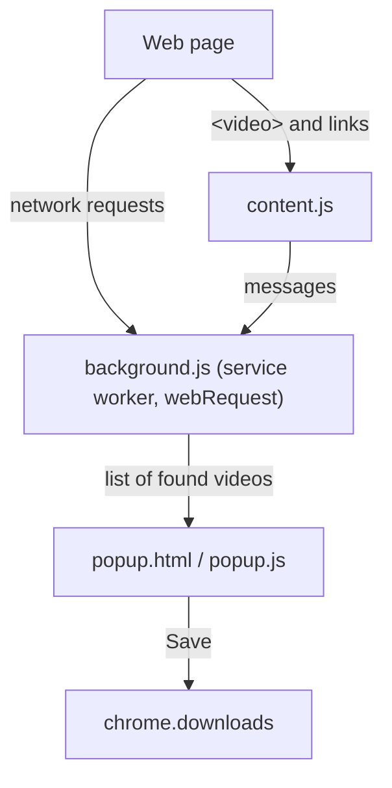

  
  
  
  

<a href="https://mrzroot.github.io/universal-video-downloader/">Website</a> · <a href="#فارسی">فارسی</a> · <a href="CHANGELOG.md">Changelog</a> · <a href="CONTRIBUTING.md">Contributing</a>

# Super Video Downloader

A small browser extension that notices the video files a web page loads (MP4, WebM, HLS playlists and more), lists
them in a popup, and lets you save or copy each link. It runs entirely in your browser: no server, no account, no
tracking. Use it only for videos you are allowed to download.

## Quick start

1. Download or clone this repository.
2. Open `chrome://extensions` (Edge: `edge://extensions`, Brave: `brave://extensions`).
3. Turn on **Developer mode** and click **Load unpacked**, then pick the folder that contains `manifest.json`.
4. Pin the extension, play a video on any page, and click the icon to see what it found.

## Features

- **Spots video requests** as the page loads them: `.mp4`, `.webm`, `.mkv`, `.mov`, `.m4v`, `.flv`, `.avi`, `.ts`, `.m3u8` (HLS) and `.mpd` (DASH).
- **Also checks the page itself** for `<video>`, `<source>` and direct video links.
- **Save or copy** each link from the popup, with its detected format.
- **Course-page helper** (Maktabkhooneh): from a course outline it visits each lesson page and collects the video links it finds, slowly, one at a time.
- Everything stays in your browser.

## How it works

`background.js` watches request URLs and content types for video formats and keeps a per-tab list. `content.js` adds
what it can see in the page. The popup shows that list and hands a chosen URL to the browser's own download manager.

## Limits (please read)

- **HLS (`.m3u8`) and DASH (`.mpd`) are playlists, not videos.** Saving one gives you the small playlist file. To get a
  playable file, copy the link and use a tool such as `ffmpeg -i "<link>" -c copy out.mp4` or `yt-dlp "<link>"`.
- DRM-protected streams (Netflix, Spotify and similar) cannot be saved, and that is intended.
- Sites that need cookies or signed links may refuse a download started outside the player.
- Not published in a browser store; load it unpacked as above. Firefox is not supported yet.

## فارسی

**Super Video Downloader** یک افزونه‌ی کوچک برای کروم، اج و بریو است. وقتی صفحه‌ای ویدیو پخش می‌کند، لینک فایل‌های ویدیو (MP4، WebM، فهرست پخش HLS و ...) را پیدا می‌کند و در یک پنجره‌ی کوچک نشان می‌دهد تا ذخیره یا کپی‌شان کنی. همه‌چیز داخل مرورگر خودت انجام می‌شود و چیزی به سرور فرستاده نمی‌شود. فقط ویدیوهایی را دانلود کن که اجازه‌اش را داری.

**نصب:**
1. مخزن را دانلود یا کلون کن.
2. صفحه‌ی `chrome://extensions` را باز کن.
3. **Developer mode** را روشن کن، **Load unpacked** را بزن و پوشه‌ای را که `manifest.json` دارد انتخاب کن.
4. آیکون افزونه را سنجاق کن، ویدیو را پخش کن و روی آیکون بزن.

**نکته‌ی مهم:** فایل `m3u8` خودِ ویدیو نیست، فهرست تکه‌های آن است. برای ساختن یک فایل قابل پخش، لینک را کپی کن و با `ffmpeg` یا `yt-dlp` ذخیره‌اش کن. ویدیوهای قفل‌دار (DRM) ذخیره نمی‌شوند.

## Contributing

Bug reports and ideas are welcome in [issues](../../issues/new/choose). See [CONTRIBUTING.md](CONTRIBUTING.md).

## License

MIT, see [LICENSE](LICENSE). Made by M-R-Z ([@mrzroot](https://github.com/mrzroot)).
